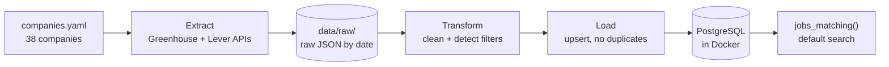
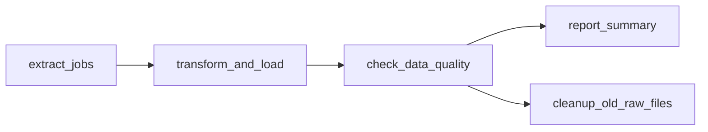

# AI Job Market Assistant

A data platform that collects real US tech job postings every day, cleans them, and detects the details job seekers actually filter on but most job sites handle badly: **visa sponsorship**, **contract type (C2C / W2 / 1099)**, **experience level**, **years of experience**, **security clearance**, and **salary**.

> **Status:** Phase 1 (data pipeline), Phase 1b (daily scheduling with Apache Airflow) and Phase 1c (H-1B sponsorship history) complete. Next: a FastAPI backend and Claude-powered features (resume matching and an AI job-search agent).

---

## What it does

- **Collects** postings from the public job-board APIs of 38 US tech companies (Greenhouse and Lever): about 9,400 jobs per run.
- **Cleans** them into one standard format: removes HTML, normalises titles ("Sr. Data Eng" → "Senior Data Engineer"), detects country and remote status, and converts hourly or monthly pay to yearly.
- **Detects filters** from the job text, saving the **exact sentence** used as evidence for sponsorship and contract type:

| Filter | Values |
|---|---|
| Employment type | full_time, part_time, contract, internship, temporary, unknown |
| Contract type | any of c2c, w2, 1099 (e.g. "W2 only, no C2C" → `w2`) |
| Experience level | entry, mid, senior, lead, manager, director_plus, unknown |
| Years of experience | number, e.g. "5+ years" → 5 |
| Visa sponsorship | yes, no, unknown (never assumed "yes") |
| Security clearance | required / not mentioned |
| Salary | min / max, currency, period (year, month, hour) and a yearly equivalent |
| Skills | 84 skills in categories (languages, cloud, data engineering, AI/ML...) |
| Role family | data_engineer, ml_engineer, data_scientist, data_analyst, software_engineer, other |

- **Adds H-1B history** from US Department of Labor data: for each job, how many H-1B applications the company filed for that role family last year and at what salary, even when the posting says nothing about sponsorship.
- **Stores** everything in PostgreSQL with constraints that reject bad data, and provides a default search that keeps jobs with unstated details instead of hiding them.

## Architecture



| Step | File | Notes |
|---|---|---|
| Extract | [`pipeline/extract.py`](pipeline/extract.py), [`pipeline/sources/`](pipeline/sources/) | Polite: one request per second with retries. One failing company never stops the run. Raw responses are saved unchanged so Transform can be re-run without downloading again. |
| Transform | [`pipeline/transform.py`](pipeline/transform.py), [`pipeline/rules.py`](pipeline/rules.py) | Each rule is a small pure function, unit-tested on its own. |
| Load | [`pipeline/load.py`](pipeline/load.py) | Upserts on `(source, source_job_id)`, so re-running updates jobs instead of duplicating them. One transaction per run. |
| Orchestration | [`pipeline/run_pipeline.py`](pipeline/run_pipeline.py) | Logs every run (status, counts, errors) to the `pipeline_runs` table. |
| Quality checks | [`pipeline/quality.py`](pipeline/quality.py) | Fails the run on 0 jobs loaded, duplicates, missing fields, >25% of companies failing, a drop below 50% of the last run, or >5% of jobs with no country. |
| Scheduling | [`airflow/dags/job_market_pipeline.py`](airflow/dags/job_market_pipeline.py) | Apache Airflow 3.3 DAG, daily at 13:00 UTC, 2 retries per task. |

### H-1B sponsorship history

About 91% of postings say nothing about visa sponsorship. To fill that gap, [`pipeline/h1b.py`](pipeline/h1b.py) loads the US Department of Labor's **LCA disclosure file**. An LCA (Labor Condition Application) is the first step an employer files before sponsoring an H-1B worker, so it shows intent to sponsor, not a final visa approval.

- Streams the Excel file row by row (230,263 rows in about 2 minutes), keeps **certified H-1B** applications, converts wages to yearly, and stores a summary per **fiscal year × employer × role family**: filings, median and quartile wages, top states and titles.
- Applies the **same role-family rule** to DOL job titles and to job postings, so a "Data Engineer" posting is compared with the company's data engineer filings.
- **Matches DOL employer names to our companies**: names are cleaned ("Stripe, Inc." → `STRIPE`; "Formagrid Inc. d/b/a Airtable" → `FORMAGRID`), and legal names that differ from the brand are listed in [`h1b_aliases.yaml`](pipeline/config/h1b_aliases.yaml) (Instacart = Maplebear, Airtable = Formagrid). A `--report` lists similar unmatched names so misses are caught, and every decision is noted in that file.

| View | Shows |
|---|---|
| `company_h1b_summary` | Filings and typical wage per company, fiscal year and role family |
| `job_h1b_history` | For each job: the company's filings for that role family and in total, for the latest year |

```sql
SELECT j.title, h.h1b_role_filings, h.h1b_role_wage_typical
FROM jobs_matching() j JOIN job_h1b_history h ON h.job_id = j.id
WHERE j.role_family = 'data_engineer';
```

**FY 2026 results (Oct 2025 – Jun 2026):** 221,299 certified H-1B applications from about 40,000 employers. **36 of our 38 companies** filed; the most active were Databricks (272), DoorDash (250), Zoox (210) and Stripe (167). In the default search, the company filed H-1Bs for the same role for **1,260 of 1,291** software engineer jobs and **218 of 235** AI/ML jobs.

DOL updates the file each quarter and blocks automated downloads, so this step runs by hand rather than in the daily DAG.

### Daily schedule (Apache Airflow)



| Task | What it does |
|---|---|
| `extract_jobs` | Downloads all companies and saves raw files. Fails only if no company can be reached. |
| `transform_and_load` | Re-processes the saved raw files and upserts into PostgreSQL, so a retry never re-downloads. |
| `check_data_quality` | Runs the quality checks; no automatic retry, because a failure needs a person to look. |
| `report_summary` | Logs the day's numbers (new jobs, matches for the default search, sponsoring jobs). |
| `cleanup_old_raw_files` | Keeps only the last 14 days of raw files. |

The setup is deliberately lean for an 8 GB laptop: one Airflow container in `standalone` mode with `LocalExecutor`, its metadata in a separate `airflow` database on the same PostgreSQL server, a 2.5 GB memory cap, and a UI bound to `127.0.0.1` only (so no login). It uses about 1.3 GB of RAM. The same DAG can run on a managed service such as Amazon MWAA or Google Cloud Composer.

### Database

Defined in [`database/schema.sql`](database/schema.sql):

| Table | Holds |
|---|---|
| `companies` | One row per company |
| `jobs` | One row per posting: 30 columns including every filter above |
| `skills` | Skill names and categories |
| `job_skills` | Which job needs which skills (many-to-many) |
| `pipeline_runs` | History log of each pipeline run |
| `h1b_filings` | H-1B application summaries per fiscal year, employer and role family |

Data quality is enforced in the database itself: unique jobs, valid foreign keys, allowed values only (e.g. `sponsorship IN ('yes','no','unknown')`), and `salary_min <= salary_max`.

### Default search: `jobs_matching()`

All jobs are stored, and filters are applied when searching, so limits can change without losing data.

```sql
SELECT * FROM jobs_matching();                              -- defaults below
SELECT * FROM jobs_matching(100000, 5);                     -- $100k+, at most 5 years required
SELECT * FROM jobs_matching(only_country => 'IN');          -- another country
SELECT * FROM jobs_matching(needs_sponsorship => false);    -- include no-sponsorship jobs
```

| Setting | Default | Rule |
|---|---|---|
| `min_salary` | 60000 | Top of the yearly USD range must reach it. Jobs with no salary stated are kept. |
| `max_years_required` | 8 | Job must not require more years. Jobs with no requirement stated are kept. |
| `only_country` | `'US'` | US jobs plus remote jobs open worldwide |
| `needs_sponsorship` | `true` | Hides jobs that say they won't sponsor a visa or that need a security clearance |

## Results from the first full run (14 Nov 2026)

- **9,367 jobs** from 38 companies; **6,132 in the US**; **5,138** match the default search.
- Salary found in **57%** of postings (thanks to US pay-transparency laws); years of experience in **66%**.
- Sponsorship: **683** postings say yes, **151** say no, and **8,533 (91%) don't say**. That gap is what the planned H-1B history feature addresses.
- Most requested skills: Data Engineer: Python, SQL, ETL, dbt, Spark, Snowflake. AI/ML Engineer: LLMs, machine learning, Python, PyTorch.

**Checking against real data mattered.** Reviewing real postings found rule bugs that hand-written examples didn't, including an export-licence sentence ("without sponsorship for an export license") that wrongly marked **480 jobs** as "no visa sponsorship". Each bug now has a regression test.

## Run it yourself

**Requirements:** Python 3.12, Docker Desktop, Git.

```bash
git clone https://github.com/SaiCharan2199/App-Development.git
cd App-Development

python -m venv .venv
.venv\Scripts\activate            # Windows  (macOS/Linux: source .venv/bin/activate)
pip install -r requirements.txt

copy .env.example .env            # then set your own POSTGRES_PASSWORD  (macOS/Linux: cp)
docker compose up -d              # start PostgreSQL
python -m pipeline.init_db        # create the tables
python -m pipeline.run_pipeline   # collect, clean and load the jobs
```

Useful options:

```bash
python -m pipeline.run_pipeline --companies stripe zoox      # only some companies
python -m pipeline.run_pipeline --from-raw 2026-11-14        # re-process saved raw data
python -m pipeline.run_pipeline --dry-run                    # no database writes
```

### Run it every day with Airflow

```bash
# add AIRFLOW_FERNET_KEY and AIRFLOW_SECRET_KEY to .env first (see .env.example)
docker compose --profile airflow up -d --build    # start PostgreSQL + Airflow
```

Open **http://localhost:8080** to see runs, task logs and the next scheduled time, or click **Trigger** to run now. Stop it with `docker compose --profile airflow down` (data is kept). The daily run only happens while the computer is on and Docker is running.

On an existing database created before Airflow was added, create Airflow's database once:

```bash
docker exec jobs-postgres sh -c 'psql -U "$POSTGRES_USER" -d "$POSTGRES_DB" -c "CREATE DATABASE airflow"'
```

### Load H-1B history (quarterly, by hand)

1. On [DOL's performance data page](https://www.dol.gov/agencies/eta/foreign-labor/performance), under **LCA Programs**, download the latest **LCA Disclosure Data** `.xlsx` file into `data/h1b/`.
2. Run:

```bash
python -m pipeline.h1b data/h1b/LCA_Disclosure_Data_FY2026_Q3.xlsx --check-columns   # check first
python -m pipeline.h1b data/h1b/LCA_Disclosure_Data_FY2026_Q3.xlsx                   # load (about 2 minutes)
python -m pipeline.h1b --report                                                      # review company matching
```

Loading a fiscal year again replaces that year's rows, so re-running is safe.

To add a company, add a line to [`pipeline/config/companies.yaml`](pipeline/config/companies.yaml). To add a skill, edit [`pipeline/config/skills.yaml`](pipeline/config/skills.yaml).

## Tests

```bash
pytest
```

196 tests: rule-by-rule unit tests, transform tests on sample Greenhouse and Lever jobs (no internet needed), data quality and cleanup tests, H-1B tests (name cleaning, wages, and a small generated Excel file), and database tests for the search filter, constraints and H-1B views. Database tests run inside a rolled-back transaction, and are skipped automatically if Docker isn't running.

## Roadmap

- [x] **Phase 1:** ETL pipeline, database, filter detection, tests
- [x] **Phase 1b:** Daily scheduling with Apache Airflow, with data quality checks
- [x] **Phase 1c:** H-1B sponsorship history from public US Department of Labor data, matched to companies
- [ ] **Phase 2:** FastAPI backend (job search, trending skills)
- [ ] **Phase 3:** Claude features: resume matcher, AI job-search agent, and LLM filter detection compared against the rules
- [ ] **Phase 4:** Web frontend, CI with GitHub Actions, deployment

## Tech stack

Python 3.12 · PostgreSQL 16 · Apache Airflow 3.3 · Docker · `requests` · `psycopg` · BeautifulSoup · PyYAML · pytest

## Data sources

Job data comes from the public [Greenhouse Job Board API](https://docs.greenhouse.io/job-board.html) and [Lever Postings API](https://github.com/lever/postings-api), which companies use to publish their openings. The pipeline makes at most one request per second, and each job links back to the original posting.

H-1B history comes from the US Department of Labor's [public LCA disclosure data](https://www.dol.gov/agencies/eta/foreign-labor/performance). The downloaded files are not stored in this repository.
